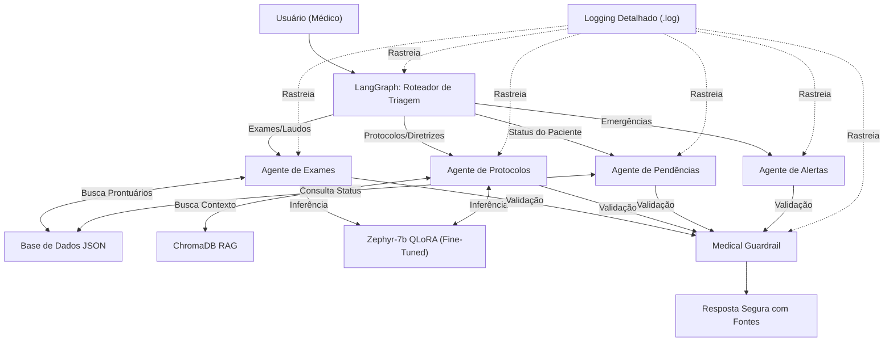

# Assistente Médico Virtual com IA (Tech Challenge - Fase 3)

Este projeto é a entrega final da Fase 3 da pós-graduação em IA para Devs da FIAP. Trata-se de um assistente virtual médico baseado em Inteligência Artificial, capaz de auxiliar nas condutas clínicas, responder dúvidas e sugerir procedimentos com base em protocolos internos.

## 🎯 Objetivos e Requisitos Atendidos
* **Fine-Tuning de LLM:** Modelo `Zephyr-7b-beta` treinado com QLoRA utilizando dados médicos, protocolos e laudos sintéticos.
* **Orquestração com LangGraph (Multi-Agent):** Pipeline inteligente com múltiplos agentes especializados para consultas em bases estruturadas (JSON) e não estruturadas via RAG (ChromaDB).
* **Segurança e Validação (Guardrails):** Implementação de limites rigorosos de atuação, garantindo que o assistente não prescreva tratamentos diretamente e sempre exiba avisos de segurança.
* **Explicabilidade (Explainability):** O sistema retorna as fontes utilizadas (IDs de exames, trechos de documentos), garantindo auditoria clínica.

## 🏗️ Arquitetura do Sistema

O fluxo de decisão foi construído utilizando LangGraph, separando as responsabilidades entre 4 agentes especializados:



## 📁 Estrutura de Diretórios

```text
assistente-medico-llm/
├── data/
│   ├── raw/                 # Protocolos em TXT e Exames em JSON
│   └── vector_db/           # Banco de dados vetorial (ChromaDB)
├── src/
│   ├── agent/               # Agentes (Exames, Protocolos, Pendências, Alertas) e Workflow (LangGraph)
│   ├── data_prep/           # Scripts de preparação de dados
│   ├── fine_tuning/         # Scripts de treinamento (QLoRA)
│   ├── guardrails/          # Travas de segurança (Medical Guardrail)
│   ├── rag/                 # Configuração do ChromaDB e Retriever
│   └── utils/               # Utilitários e logs nativos
├── main.py                  # Ponto de entrada do sistema interativo local
├── requirements.txt         # Dependências do projeto
└── Apresentacao_Maxima.ipynb # Notebook final para demonstração no Colab
```

## 🚀 Como Executar Localmente

1. **Clone o repositório e entre na pasta:**
   ```bash
   git clone https://github.com/MAntonioST/assistente-medico-llm.git
   cd assistente-medico-llm
   ```

2. **Crie e ative um ambiente virtual:**
   ```bash
   python3 -m venv venv
   source venv/bin/activate
   ```

3. **Instale as dependências:**
   ```bash
   pip install -r requirements.txt
   ```

4. **Execute o sistema interativo no terminal:**
   ```bash
   python3 main.py
   ```

## 🧪 Exemplos de Uso no Terminal
- **Protocolos:** "Qual o tratamento padrão para hipertensão?"
- **Exames:** "Resultado do exame do Robert Johnson"
- **Pendências:** "Exames pendentes do Robert Johnson"
- **Alertas:** "Emitir alerta de emergência"

## ☁️ Execução na Nuvem (Google Colab)
Para testar o modelo com a LLM real (Fine-Tuned) utilizando aceleração de GPU, faça o upload do arquivo `Apresentacao_Maxima.ipynb` no Google Colab e execute as células sequencialmente.
