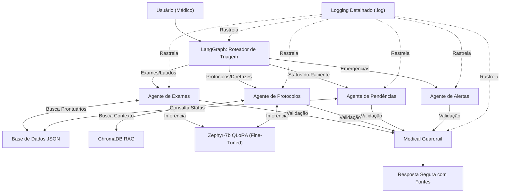

# 🩺 Tech Challenge - Assistente Médico Virtual com IA
Fase 3 - IA Foundations
FIAP - Pós-Graduação em IA para DEVs
Autor: Marco Antonio Teixeira

## 📝 Descrição
Este projeto implementa um assistente virtual médico baseado em Inteligência Artificial para apoiar condutas clínicas e responder dúvidas médicas com base em protocolos internos. A solução foi desenvolvida utilizando técnicas avançadas de IA Generativa:

- **Fine-Tuning:** Treinamento do modelo `Zephyr-7b-beta` com QLoRA utilizando dados médicos, protocolos e laudos sintéticos.
- **Multi-Agent System:** Orquestração de múltiplos agentes especializados utilizando **LangChain** e **LangGraph**.
- **RAG (Retrieval-Augmented Generation):** Consultas a bases de dados estruturadas (JSON) e não estruturadas (ChromaDB) para contextualizar as respostas.
- **Segurança (Guardrails):** Implementação de travas de segurança rigorosas para evitar prescrições diretas e garantir a explicabilidade (fontes) das respostas.

⚠️ **Nota importante:** este sistema é uma ferramenta preditiva de apoio à decisão médica. O diagnóstico final e a prescrição de tratamentos sempre devem ser confirmados por um profissional de saúde qualificado.

## 🏗️ Arquitetura da Solução
O projeto segue princípios de modularidade, separando as responsabilidades em módulos específicos dentro da pasta `src/`. O fluxo de decisão automatizado é coordenado pelo LangGraph:



## 🚀 Como executar
### 1. Clone o repositório e configure o ambiente
```bash
git clone https://github.com/MAntonioST/assistente-medico-llm.git
cd assistente-medico-llm

# Crie e ative o ambiente virtual
python3 -m venv venv
source venv/bin/activate  # Linux/macOS
venv\Scripts\activate     # Windows

# Instale as dependências
pip install -r requirements.txt
```

### 2. Execute o pipeline local interativo
```bash
python3 main.py
```
*Exemplos de perguntas para testar o roteamento:*
- **Protocolos:** "Qual o tratamento padrão para hipertensão?"
- **Exames:** "Resultado do exame do Robert Johnson"
- **Pendências:** "Exames pendentes do Robert Johnson"
- **Alertas:** "Emitir alerta de emergência"

### 3. Execução na Nuvem (Google Colab)
Para testar o modelo com a LLM real (Fine-Tuned) utilizando aceleração de GPU, faça o upload do arquivo `Apresentacao_Maxima.ipynb` no Google Colab e execute as células sequencialmente.

## 📂 Estrutura do Projeto
```text
assistente-medico-llm/
├── main.py                 # Orquestrador principal interativo
├── requirements.txt        # Dependências do projeto
├── .gitignore              # Arquivos ignorados pelo Git
├── data/
│   ├── raw/                # Protocolos em TXT e Exames em JSON
│   └── vector_db/          # Banco de dados vetorial (ChromaDB)
├── src/                    # Módulos do sistema
│   ├── agent/              # Agentes (Exames, Protocolos, Pendências, Alertas) e Workflow (LangGraph)
│   ├── data_prep/          # Scripts de preparação de dados
│   ├── fine_tuning/        # Scripts de treinamento (QLoRA)
│   ├── guardrails/         # Travas de segurança (Medical Guardrail)
│   ├── rag/                # Configuração do ChromaDB e Retriever
│   └── utils/              # Utilitários e logs nativos
└── Apresentacao_Maxima.ipynb # Notebook final para demonstração no Colab
```

## 🛠️ Tecnologias Utilizadas
- **Linguagem:** Python 3.12+
- **LLM & Fine-Tuning:** HuggingFace, PEFT, QLoRA, `Zephyr-7b-beta`
- **Orquestração de Agentes:** LangChain, LangGraph
- **RAG & Vector DB:** ChromaDB, Sentence-Transformers (`all-MiniLM-L6-v2`)
- **Ambiente de Treinamento:** Google Colab (GPU T4)

## 📄 Licença
Este projeto está sob a licença MIT. Veja o arquivo LICENSE para mais detalhes.
