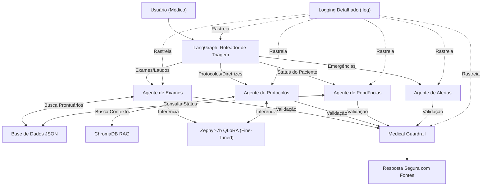

# Assistente Médico LLM - Tech Challenge Fase 3

Este projeto implementa um assistente virtual médico baseado em Inteligência Artificial, desenvolvido para o Tech Challenge da Fase 3 da pós-graduação da FIAP. O sistema utiliza uma LLM fine-tunada, LangChain e LangGraph para orquestrar múltiplos agentes especializados.

## 🏗️ Arquitetura do Sistema (LangGraph)

O fluxo de decisão automatizado é coordenado pelo LangGraph, roteando a requisição do usuário para o agente mais adequado:

## 🚀 Como Executar Localmente

1. Crie e ative um ambiente virtual:
   `python3 -m venv venv`
   `source venv/bin/activate`

2. Instale as dependências:
   `pip install -r requirements.txt`

3. Execute o sistema interativo no terminal:
   `python3 main.py`

## 🧪 Exemplos de Uso
- **Protocolos:** "Qual o tratamento padrão para hipertensão?"
- **Exames:** "Resultado do exame do Robert Johnson"
- **Pendências:** "Exames pendentes do Robert Johnson"
- **Alertas:** "Emitir alerta de emergência"
