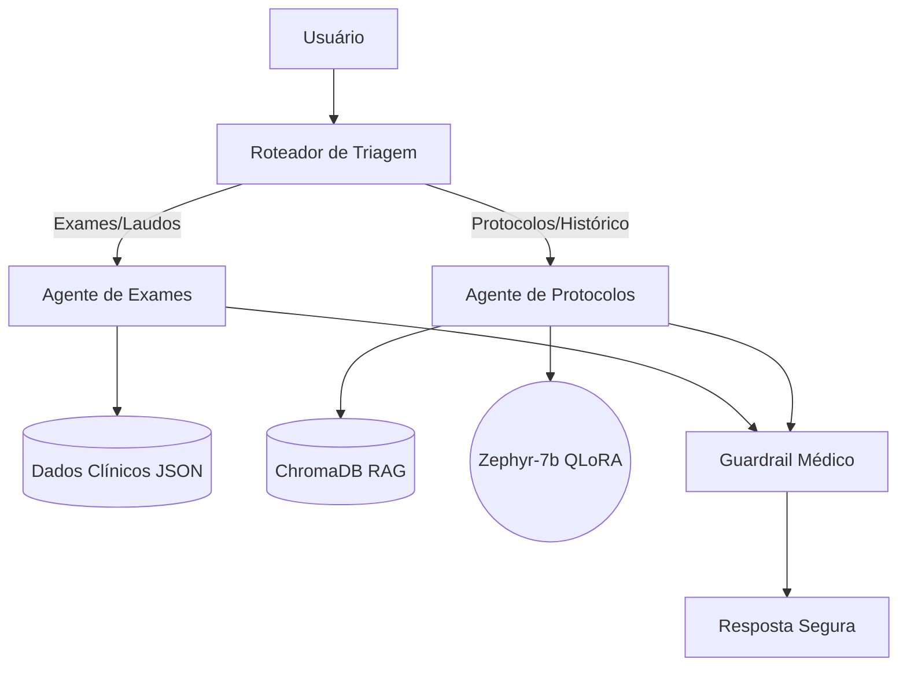

# Assistente Médico Virtual com IA (Tech Challenge - Fase 3)

**Aviso Legal:** Este projeto tem fins estritamente acadêmicos e foi desenvolvido para o Tech Challenge da FIAP. O assistente não deve ser utilizado para diagnósticos reais ou prescrição de tratamentos sem a supervisão e validação de um profissional de saúde qualificado.

Este repositório contém a solução desenvolvida para a Fase 3 do Tech Challenge da pós-graduação em Inteligência Artificial para Devs da FIAP.

O projeto consiste em um **Assistente Virtual Médico** projetado para auxiliar profissionais de saúde em condutas clínicas, responder dúvidas e sugerir procedimentos com base em protocolos internos, utilizando fluxos de decisão automatizados e seguros.

## 🎯 Objetivos e Requisitos Atendidos

* **Fine-Tuning de LLM:** Ajuste fino do modelo open-source Zephyr-7b utilizando QLoRA com dados médicos.
* **Orquestração com LangGraph:** Pipeline inteligente com múltiplos agentes para consultas em bases de dados estruturadas (JSON) e dados não estruturados via RAG (ChromaDB).
* **Segurança e Validação (Guardrails):** Implementação de limites rigorosos de atuação, garantindo que o assistente não prescreva tratamentos diretamente.

## 🧠 Arquitetura do Sistema

O fluxo de decisão foi construído utilizando LangGraph, separando as responsabilidades entre agentes especializados:



## 📂 Estrutura de Diretórios

```text
assistente-medico-llm/
├── data/
│   ├── raw/             # Protocolos em TXT e Exames em JSON
│   └── vector_db/       # Banco de dados vetorial (ChromaDB)
├── src/
│   ├── agent/           # Lógica do LangGraph (Roteador, Agentes, Estado)
│   ├── guardrails/      # Filtros de segurança e validação
│   └── rag/             # Configuração do Retriever e Embeddings
├── main.py              # Ponto de entrada da aplicação (Terminal)
└── requirements.txt     # Dependências do projeto
```

## 🚀 Como Executar Localmente

O projeto foi desenhado para rodar localmente, sem necessidade de chaves de API externas para a inferência principal.

**1. Clone o repositório:**
```bash
git clone https://github.com/MAntonioST/assistente-medico-llm.git
cd assistente-medico-llm
```

**2. Crie e ative o ambiente virtual:**
```bash
python3 -m venv venv
source venv/bin/activate
```

**3. Instale as dependências:**
```bash
pip install -r requirements.txt
```

**4. Execute o assistente:**
```bash
python3 main.py
```

## 👨‍💻 Autor
* **Marco Antonio Teixeira** - FIAP (Pós-Graduação em IA para Devs)

## 📄 Licença
Este projeto está sob a licença MIT.
